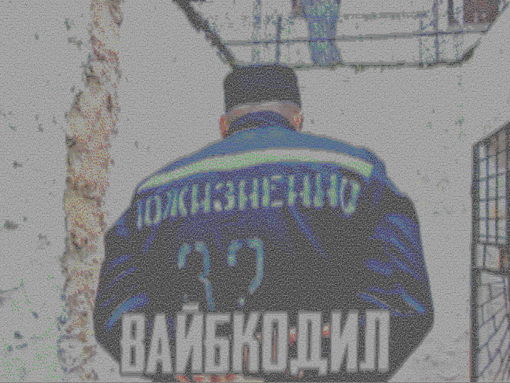

# ascii_dither
JPEG → JPEG, собранный из ASCII-символов 16 стандартных ANSI-цветов, с контурной обводкой объектов.

 ascii_dither.py — JPEG → JPEG, собранный из ASCII-символов 16 стандартных
                   ANSI-цветов, с контурной обводкой объектов.

  

ЧТО ДЕЛАЕТ ПРОГРАММА
--------------------
  * Читает JPEG/PNG и перерисовывает его символами ASCII в 16 цветах
    (стандартная палитра xterm/ANSI).
  * Внутри однородных участков применяется дизеринг Флойда–Штейнберга:
    цвет, которого нет в палитре, воспроизводится СМЕСЬЮ символов
    нескольких палитровых цветов — так «внедрением другого цвета»
    получается похожий оттенок на крупных областях.
  * Символы ставятся в ПРОИЗВОЛЬНЫЕ позиции внутри своих ячеек
    (не по строгой сетке строк/столбцов), поэтому картинка не выглядит
    решёткой.
  * На границах объектов детектор краёв (Sobel) ставит символы по
    направлению контура: '|', '/', '\\', '--' (тонкая горизонталь) и
    '__' (жирная, для сильных границ).
  * Результат сохраняется как JPEG (quality=95, subsampling=0 — без
    хроматического размытия, чтобы 16 цветов оставались чистыми).

ЗАВИСИМОСТИ
-----------
    pip install pillow

ЗАПУСК (общий вид)
------------------
    python ascii_dither.py <input> <output> [опции]

ПРИМЕРЫ
-------
    # самый простой запуск, чёрный фон
    python ascii_dither.py photo.jpg out.jpg

    # крупные символы, апскейл ×2, светлая подложка
    python ascii_dither.py photo.jpg out.jpg -f 20 --scale 2 --bg white

    # детальная прорисовка: мелкие символы + максимум контуров
    python ascii_dither.py photo.jpg out.jpg -f 10 --scale 3 -e 0.08 -j 0.5

    # только заливка, без обводки
    python ascii_dither.py photo.jpg out.jpg --no-edges

    # фиксированное «зерно» — один и тот же результат при каждом запуске
    python ascii_dither.py photo.jpg out.jpg -s 42

ВСЕ ФЛАГИ
---------
*  ПОЗИЦИОННЫЕ
    input                Путь к входному файлу (JPEG, PNG и т. п.).
    output               Путь к выходному файлу; формат определяется
                         расширением — рекомендуется .jpg.

*  РАЗМЕР И ШРИФТ
    -f, --font-size N    Размер шрифта в пикселях. По умолчанию
                         max(8, min(ширина, высота) // 40), то есть
                         ~1/40 от меньшей стороны.
                           Меньше N → больше ячеек, детальнее и медленнее.
                           Больше N → крупнее символы, картинка грубее.
    --scale K            Масштаб выходного изображения (по умолчанию 1.0).
                         Холст = исходные размеры × K. Нужен, когда хочется
                         разглядеть символы: при мелком шрифте и большом
                         исходнике --scale 2–3 даёт крупный читаемый файл.

*  РАЗБРОС СИМВОЛОВ (антисетка)
    -j, --jitter F       Разброс позиции символа внутри его ячейки,
                         доля от размера ячейки, 0..1 (по умолчанию 0.40).
                           j = 0    строгая сетка (для сравнения)
                           j ≈ 0.4  «живой» вид, символы плавают
                           j ≈ 0.7  сильный разброс, почти пуантилизм
                         Контурные символы всегда ставятся почти без
                         разброса (±0.10), иначе линия будет рваной.

*  КОНТУРЫ ОБЪЕКТОВ
    -e, --edge-threshold F
                         Порог обнаружения края, 0..1 (по умолчанию 0.12).
                         Край рисуется там, где нормированный Sobel-модуль
                         превышает порог.
                           Меньше F (0.05–0.08) → больше контуров, ловятся
                                                даже слабые границы.
                           Больше F (0.20–0.30) → только очень сильные края,
                                                очертания крупных объектов.
    --no-edges           Полностью отключить контурную обводку. Полезно,
                         если хочется чистой заливки без «стенок» вокруг
                         каждой детали.

*  ЦВЕТ ПОДЛОЖКИ
    --bg {black,white}   Цвет фона (по умолчанию black). Влияет и на
                         подложку, и на предсказанные цвета ячеек при
                         дизеринге, поэтому для светлых исходников
                         правильнее --bg white.

*  ВОСПРОИЗВОДИМОСТЬ
    -s, --seed N         Зерно генератора случайных позиций (по умолчанию
                         42). С одним и тем же N и теми же флагами
                         результат байт-в-байт воспроизводим. Любое другое
                         N даёт другой «рисунок» тех же цветов.

*  ПРОЧЕЕ
    -h, --help           Показать справку по всем флагам и выйти.

ПАЛИТРА (16 ЦВЕТОВ)
-------------------
    0  black    (0,0,0)          8  grey      (128,128,128)
    1  maroon   (128,0,0)        9  red       (255,0,0)
    2  green    (0,128,0)       10  lime      (0,255,0)
    3  olive    (128,128,0)     11  yellow    (255,255,0)
    4  navy     (0,0,128)       12  blue      (0,0,255)
    5  purple   (128,0,128)     13  fuchsia   (255,0,255)
    6  teal     (0,128,128)     14  aqua      (0,255,255)
    7  silver   (192,192,192)   15  white     (255,255,255)

КАК ЭТО РАБОТАЕТ (кратко)
-------------------------
  1. Исходник уменьшается до сетки «ячеек» (LANCZOS) — по одной
     точке на ячейку.
  2. Floyd–Steinberg выбирает для каждой ячейки палитровый цвет,
     символ-заполнитель и число наложений так, чтобы визуальный средний
     цвет совпал с целью.
  3. Собель находит края и их направления; на краях символ подменяется
     на штрих, соответствующий ориентации контура.
  4. Все символы рисуются в случайных позициях внутри ячеек
     (кроме контурных — там разброс подавлен).
  5. Холст сохраняется в JPEG с quality=95 и subsampling=0.

ПОДСКАЗКИ ПО КАЧЕСТВУ
---------------------
  * Символы «слиплись» в кашу   → увеличьте --scale 2..3 или -f.
  * Мало контуров                → уменьшите -e до 0.06–0.10.
  * Слишком много штрихов        → увеличьте -e до 0.20–0.30.
  * Хочется чистого пуантилизма  → -j 0.6 --no-edges.
  * Светлый исходник тёмный      → --bg white.
  * Нужен предсказуемый результат → -s 67 (или любое другое число).

ЛИЦЕНЗИЯ
--------
  Публичное достояние (CC0). Делайте что хотите.
